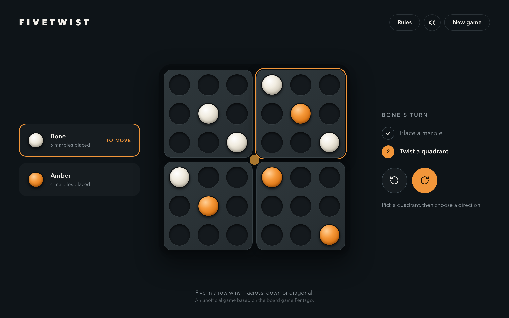

# Fivetwist

A two-player strategy game for the browser and the terminal: place a marble, twist a quadrant,
line up five.

**[Play it in your browser](https://jeremygillard.github.io/pentago-game/)**



Fivetwist is an unofficial implementation of the board game Pentago. It is not affiliated with or
endorsed by the game's publishers.

## How to play

Two players, Bone and Amber, take turns. A turn has two steps:

1. **Place a marble** in any empty hole.
2. **Twist a quadrant** a quarter turn, clockwise or counter-clockwise. Any of the four quadrants
   can be twisted, and the twist is not optional.

The first player to line up five marbles wins, across, down or diagonally.

- Five in a row as soon as a marble is placed wins at once, without a twist.
- A twist can line up the opponent's marbles: then the opponent wins.
- If a twist lines up both players at the same time, the game is a draw.
- If the board fills up with no five in a row, the game is a draw.

## How it is built

The rules are written once, in Rust, and every interface is a thin layer on top of them.

```
crates/pentago-core   the rules: board, twists, win detection, game state. No dependencies.
crates/pentago-tui    a terminal interface (ratatui)
crates/pentago-wasm   WebAssembly bindings (wasm-bindgen) exposing the rules to JavaScript
web/                  the browser interface (Vue 3, TypeScript, Vite)
```

The web app never re-implements a rule. It asks the WebAssembly module to place or twist, then
redraws from the state it reads back; an illegal move is refused by the Rust code.

## Run it

### In the terminal

Requires [Rust](https://rustup.rs).

```sh
cargo run -p pentago-tui
```

Arrows and Enter place a marble; arrows then `r` or `l` twist a quadrant; `q` quits.

### In the browser

Requires Rust with the WebAssembly target, [wasm-pack](https://github.com/drager/wasm-pack) and
Node `^22.18.0 || >=24.12.0`.

```sh
rustup target add wasm32-unknown-unknown
cargo install wasm-pack

cd web
npm install
npm run dev
```

`npm run dev` compiles the Rust code to WebAssembly before starting the dev server. See
[web/README.md](web/README.md) for the other commands.

## Tests

```sh
# Rust: the rules, the terminal interface and the bindings
cargo test --workspace
wasm-pack test --node crates/pentago-wasm

# Web: unit and component tests, then the game played in Chromium, Firefox and WebKit
cd web
npm run test:unit
npx playwright install   # first time only
npm run test:e2e
```

Continuous integration runs all of these, plus formatting and lint checks, on every push and pull
request, and deploys the web app to GitHub Pages from `main`.

## History

This project started in 2019 as a Java and JavaFX school project. It was rewritten in Rust as a
way to learn the language, and to fix several rule bugs of the original along the way. The Java
version is kept in the git history under the tag
[`legacy-java`](https://github.com/JeremyGillard/pentago-game/tree/legacy-java).

## Licence

[GPL-3.0-or-later](LICENSE).
